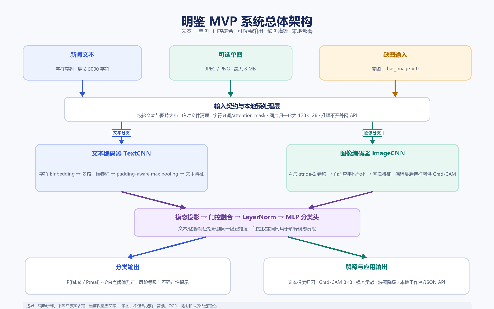

# 明鉴架构说明 v1.1（证据方向卡版）

## 1. 第一版范围

输入新闻文本 + 单张可选图像，输出：

- `P(fake)`、`P(real)` 与检查点阈值判定；
- 风险等级、置信度和不确定性提示；
- 字符级与句级文本梯度证据；
- 图像 Grad-CAM 粗粒度热图、signed CAM 与 Top-K 网格；
- 文本/图像门控贡献的幅度估计；
- 图文证据方向卡：`证据同向 / 方向冲突 / 证据不足`；
- 缺图降级、限制说明和结构化 JSON。

第一版不包含视频、音频、OCR 全链路、深度伪造定位、外部事实检索和大规模爬虫。



> 架构图中的总体关系仍适用于 v1.1；工作台截图必须从 v1.1 页面重新截取，旧截图不得冒充新界面。

## 2. 当前代码分层

```text
data/schema.py                数据契约
data/dataset.py               JSONL 读写与数据集
data/tokenization.py          字符分词器
data/torch_dataset.py         PyTorch 数据映射与图像预处理
data/weibo17.py               Weibo17 本地适配器与审计
models/lite.py                TextCNN + ImageCNN + 门控融合
training/lite_runner.py       训练、阈值调优、早停、预测收集
evaluation/metrics.py         分类指标与 ECE
explain/lite_explainer.py     文本归因、Grad-CAM、证据方向卡
inference/lite_predictor.py   检查点加载与单条推理
web/app.py                    无 API Key 本地工作台和 JSON API
scripts/audit_evidence_cards.py  真实检查点三态分布审计
```

## 3. lite baseline 模型结构

1. **文本编码器**：字符 Embedding → 多核一维卷积 → padding-aware max pooling。
2. **图像编码器**：4 层 strided CNN → 自适应平均池化；保留最后特征图用于 Grad-CAM。
3. **模态投影**：文本/图像特征分别映射到同一隐藏维度。
4. **门控融合**：根据拼接特征学习逐维 gate，再与 LayerNorm 和分类头连接。
5. **分类头**：两层 MLP + GELU + Dropout + 单 logit。
6. **解释输出**：梯度 × embedding 归因、Grad-CAM、门控贡献幅度、三态证据卡和缺图标志。

模型不需要下载预训练权重，能在 8 GB 显存环境中离线完成训练与推理。

## 4. 证据方向卡

证据卡复用同一次前向/反向传播，不新增可训练参数。对 fake logit 反传后：

```text
text_signed    = sum(text_feature_grad  * text_feature)
image_signed   = sum(image_feature_grad * image_feature)
text_strength  = |text_signed|  / (|text_signed| + |image_signed|)
image_strength = |image_signed| / (|text_signed| + |image_signed|)
coherence      = |sum(grad * feature)| / sum(|grad * feature|)
```

`text_strength` 是“证据占比”而非绝对置信度：两路占比合计为 1，只表示本次净有向梯度贡献在两种模态间的相对分配。

状态机：

1. 缺图 → `insufficient / missing_image`；
2. 任一方向为中性 → `insufficient / neutral_direction`；
3. 任一模态证据占比 < 10% → `insufficient / weak_modality`；
4. 任一方向稳定性 < 10% → `insufficient / unstable_direction`；
5. 两路方向相同 → `support / same_direction`；
6. 两路方向相反 → `conflict / opposite_direction`。

> 三态比较的是模型梯度证据方向，不是语义一致性、事实核验、篡改定位或因果证明。10% 是工程启发式阈值，必须通过真实数据审计。

## 5. 训练流程

- 读取本地 Weibo17 JSONL；
- 只在训练划分上构建字符词表；
- `pos_weight` 缓解类别不平衡；
- AMP 混合精度、梯度裁剪、验证集早停；
- 按验证 AUC 保存最佳权重，并在验证集网格搜索 F1 阈值；
- 输出 `model.pt`、`tokenizer.json`、`metrics.json` 和逐样本预测 CSV；
- 原始数据、权重和 artifacts 默认不进入 Git。

证据卡没有改变训练目标、优化器、数据划分或检查点，不需要重训。

## 6. 解释与降级流程

1. 输入文本编码为字符 ID 和 attention mask；
2. 有图时读取并归一化为 128×128 CHW 张量；无图时构造零图并令 `has_image=0`；
3. 前向计算概率、gate、文本/图像特征和图像特征图；
4. 对 fake logit 反传，提取文本 embedding 梯度、图像特征图梯度和两路投影特征梯度；
5. 生成文本证据、Grad-CAM、模态贡献与三态证据卡；
6. 附加“辅助研判、非因果证明、数据域限制、校准不足”等限制说明；
7. 工作台展示结构化 JSON，并记录本次会话历史。

## 7. 审计与验收

```powershell
.\.venv\Scripts\python.exe scripts\audit_evidence_cards.py `
  --checkpoint artifacts\lite_v1\model.pt `
  --data <local-weibo17-processed>\test.jsonl `
  --limit 200 `
  --out artifacts\evidence_card_audit.json
```

审计结果至少应报告：

- `support / conflict / insufficient` 数量；
- `reason_code` 分布；
- 文本/图像证据占比均值；
- 方向对分布；
- 缺图数量与错误样本。

在真实分布审计完成前，只能写“证据卡逻辑已实现”，不能写“证据卡已证明有效”。

## 8. 后续计划模块

- 语义级图文一致性与矛盾性通道（需独立训练和消融，不属于第一版）；
- 可靠性路由器与缺模态重训练；
- 温度缩放或等价概率校准；
- 批量检测、导出和审核动作闭环；
- 更严格的切分和跨事件鲁棒性评测；
- 可选的预训练文本/图像编码器替换实验。

## 9. 已实现与未实现

- [x] 接入真实 JSONL 数据管线；
- [x] 实现字符 TextCNN + 图像 CNN + 门控融合 baseline；
- [x] 完成 Weibo17 真实训练与测试；
- [x] 实现文本归因、Grad-CAM 和缺图降级；
- [x] 实现无 API Key 的本地工作台；
- [x] 实现图文梯度证据方向卡与三态审计脚本；
- [x] 完成证据卡有限样本真实分布审计并写入2026-10-29报告，披露多数返回证据不足；
- [ ] 实现语义级一致性/矛盾性双通道；
- [ ] 完成概率校准与校准后指标；
- [ ] 完成消融、跨域和缺模态系统实验；
- [x] 更新解释展示材料并导出2026-10-29技术文档；
- [x] 完成2026-10-30演示视频，平台发布状态另行核验。

## 10. 本地评审运行

评委从发布方自行准备完整研究归档，通过`scripts/prepare_local_model.py`在仓库外生成新检查点并验证CPU解释；安装、数据校验、训练与推理分开记录。命令和前提见[评委运行指南](reviewer_quickstart.md)。工作台API仅允许可信Host及同源Origin，拒绝不透明或外站Origin，命令行健康检查不受影响。
